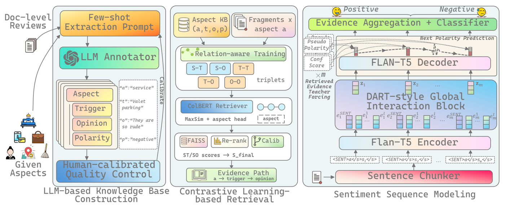
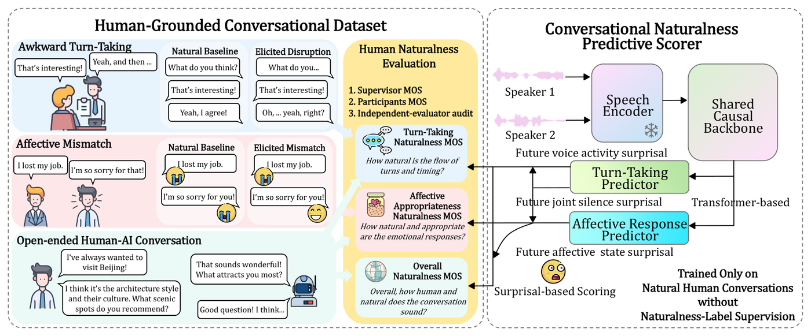
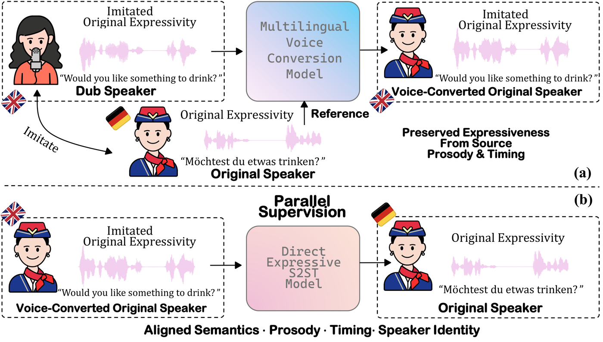
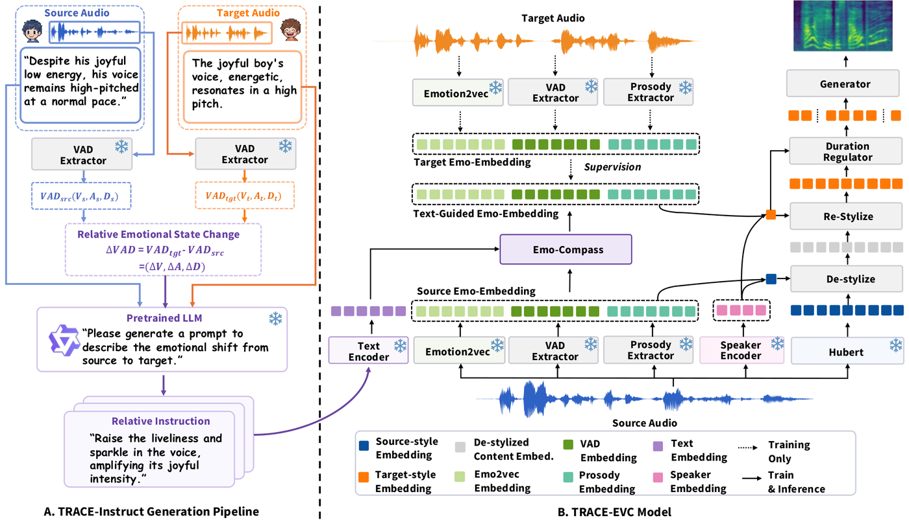
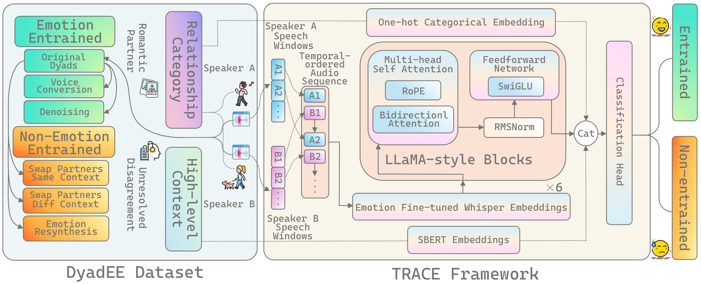
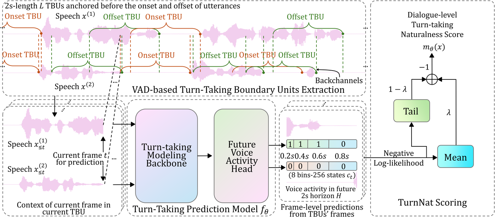
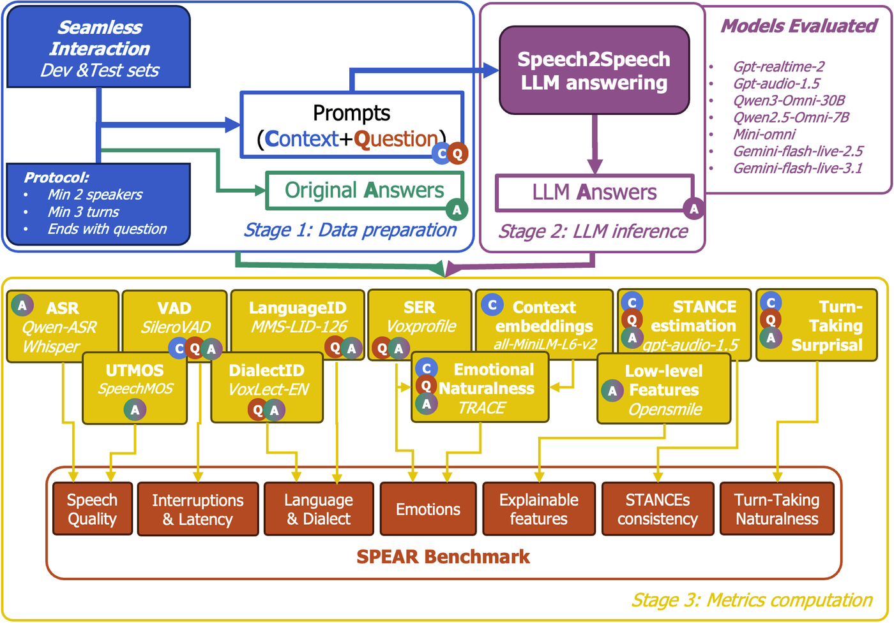
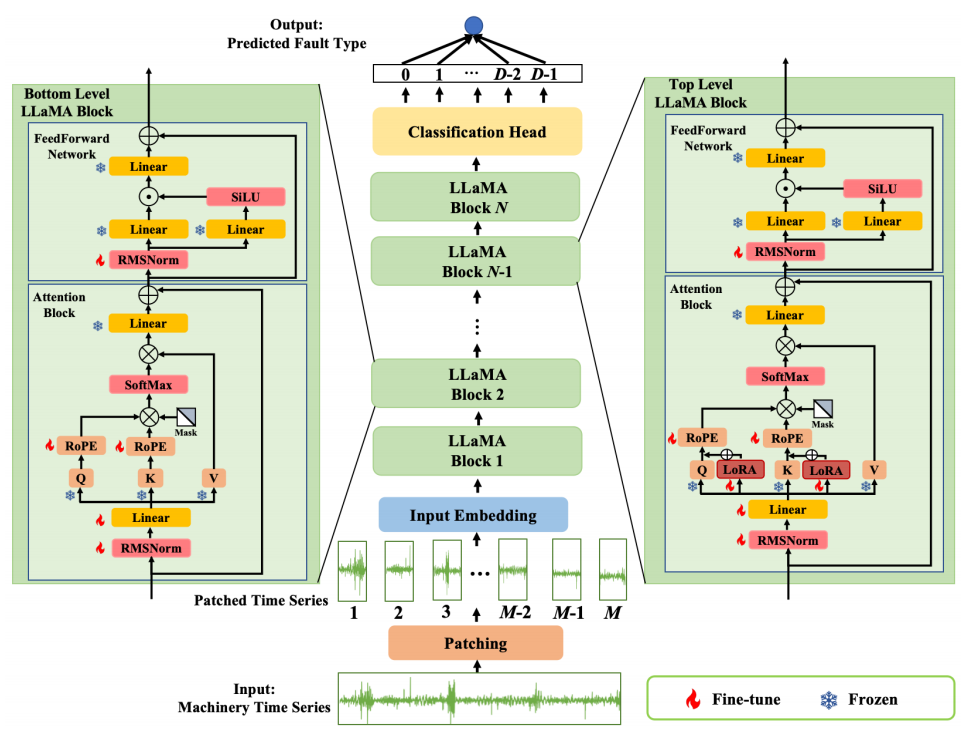
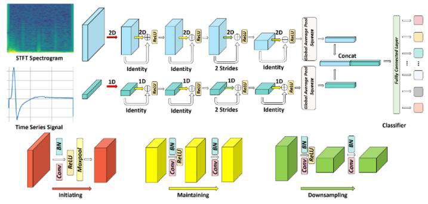

† indicates equal contribution, * indicates corresponding author.

#### Speech & Language Processing

    

        
    

    

        

            <strong>H. Zhang</strong>, R. Liu, C. Li, P. Koehn
        

        

            Learning Sentiment Dynamics: Knowledge-Augmented Sequence Modeling for Document-Level Aspect-Based Sentiment Analysis
        

        

            <strong>The 2027 Annual Conference of the Nations of the Americas Chapter of the ACL</strong>
            (<strong><a href="https://2027.naacl.org/" target="_blank">NAACL</a></strong>), 2027 (Under Review)
        

    

    

        
    

    

        

            <strong>H. Zhang</strong>, H. Gundecha, S. Dhupar, V. Ravichandran, L. Moro-Velázquez
        

        

            CONTACT: A Human-Grounded Benchmark and Surprisal-Based Predictive Scorer for Conversational Naturalness
        

        

            <strong>The Fifteenth International Conference on Learning Representations</strong>
            (<strong><a href="https://iclr.cc/Conferences/2027/index.html" target="_blank">ICLR</a></strong>), 2027 (Under Review)
        

    

    

        
    

    

        

            <strong>H. Zhang</strong>, I. R. Ulgen, B. B. Odoom, R. Liu, Z. Zhang, B. Sisman, P. Koehn
        

        

            Holistic Parallel Supervision for Expressive Speech to Speech Translation
        

        

            <strong>2027 IEEE International Conference on Acoustics, Speech, and Signal Processing</strong>
            (<strong><a href="https://2027.ieeeicassp.org/" target="_blank">ICASSP</a></strong>), 2027 (Under Review)
        

        

            [<a href="https://hzted.github.io/truly-e2e-expressive-s2st-demo" target="_blank">Demo</a>]
            [<a href="https://github.com/hzted/truly-e2e-expressive-s2st-demo" target="_blank">Code</a>]
            [<a href="https://huggingface.co/TedZhangHao/DirectS2ST" target="_blank">Model</a>]
        

    

    

        
    

    

        

            Z. Zhang, S. S. Chandra, Z. Du, X. Zhao, A. Mahapatra, <strong>H. Zhang</strong>, P. Koehn, B. Sisman
        

        

            TRACE-EVC: Text-Guided Relative Affective Control for Zero-Shot Emotional Voice Conversion
        

        

            <strong>IEEE Open Journal of Signal Processing</strong>, 2026 (Under Review)
        

        

            [<a href="https://arxiv.org/abs/2607.03666" target="_blank">arXiv</a>]
        

    

    

        
    

    

        

            S. M. Napa Ugandhar†, <strong>H. Zhang†</strong>, A. Gunzler, Y. Wang, T. Thebaud, G. Tinchev, V. Ravichandran, L. Moro-Velázquez
        

        

            TRACE: Temporal Relationship-Aware Conversational Entrainment Detection in Dyadic Speech
        

        

            <strong>IEEE Spoken Language Technology Workshop</strong>
            (<strong><a href="https://attend.ieee.org/slt-2026/" target="_blank">SLT</a></strong>), 2026
        

        

            [<a href="https://arxiv.org/abs/2606.30543" target="_blank">arXiv</a>]
        

    

    

        
    

    

        

            <strong>H. Zhang</strong>, T. Thebaud, G. Tinchev, V. Ravichandran, L. Moro-Velázquez
        

        

            TurnNat: Automatic Evaluation of Turn-Taking Naturalness in Dyadic Spoken Dialogue
        

        

            <strong>arXiv preprint</strong>, 2026
        

        

            [<a href="https://arxiv.org/abs/2607.01345" target="_blank">arXiv</a>]
            [<a href="https://hzted.github.io/turnnat-benchmark/" target="_blank">Demo</a>]
            [<a href="https://github.com/hzted/turnnat-benchmark" target="_blank">Code</a>]
            [<a href="https://huggingface.co/datasets/hzted/turnnat-benchmark" target="_blank">Dataset</a>]
        

    

    

        
    

    

        

            T. Thebaud, Y. Wang, <strong>H. Zhang</strong>, S. M. Napa Ugandhar, A. Hallur, G. Tinchev, V. Ravichandran, L. Moro-Velázquez
        

        

            SPEARBench: A Benchmark for Naturalness Evaluation in Streaming Speech-to-Speech Language Models
        

        

            <strong>Computer Speech & Language</strong>, 2026 (Under Review)
        

        

            [<a href="https://arxiv.org/abs/2607.05365" target="_blank">arXiv</a>]
        

    

#### Signal Processing & Time Series Analysis

    

        
    

    

        

            <strong>H. Zhang</strong>, T. Li*, A. Jing, S. Yang
        

        

            Sequence-Spectrogram Fusion Network for Wind Turbine Diagnosis through Few-Shot Time-Series Classification
        

        

            <strong><a href="https://www.sciencedirect.com/journal/advanced-engineering-informatics" target="_blank">Advanced Engineering Informatics</a></strong>, 2025
        

        

            [<a href="https://www.sciencedirect.com/science/article/pii/S147403462400627X" target="_blank">Paper</a>]
            [<a href="https://github.com/TedZhangHao/Few-shot-Time-series-Classification" target="_blank">Code</a>]
        

    

    

        
    

    

        

            Z. Pang, <strong>H. Zhang</strong>, T. Li*
        

        

            Hybrid Fine-Tuning in Large Language Model Learning for Machinery Fault Diagnosis
        

        

            <strong>22nd IEEE International Conference on Industrial Informatics</strong>
            (<strong><a href="https://indin2024.ieee-ies.org/" target="_blank">INDIN</a></strong>), 2024
        

        

            [<a href="https://ieeexplore.ieee.org/abstract/document/10774330" target="_blank">Paper</a>]
        

    

    

        
    

    

        

            <strong>H. Zhang</strong>, Z. Pang, J. Wang, T. Li*
        

        

            Few-Shot Learning Using Data Augmentation and Time-Frequency Transformation for Time Series Classification
        

        

            <strong>5th International Conference on Robotics, Intelligent Control and Artificial Intelligence</strong>
            (<strong><a href="https://ic-ricai.org/" target="_blank">RICAI</a></strong>), 2023 (Oral)
        

        

            [<a href="https://ieeexplore.ieee.org/abstract/document/10489648" target="_blank">Paper</a>]
        

    

    <!-- 

        
    
 -->
    

        

            B. Yang, G. Yang, K. Yang, <strong>H. Zhang</strong>, T. Li*
        

        

            Hierarchical Informative Path Planning for Active Sensing and Field Reconstruction
        

        

            <strong>3rd International Symposium on Control Engineering and Robotics</strong>
            (<strong><a href="https://www.is-cer.org/index.html" target="_blank">ISCER</a></strong>), 2024
        

        

            [<a href="https://dl.acm.org/doi/abs/10.1145/3679409.3679463" target="_blank">Paper</a>]
        

    

